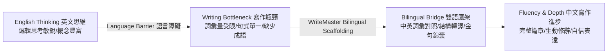
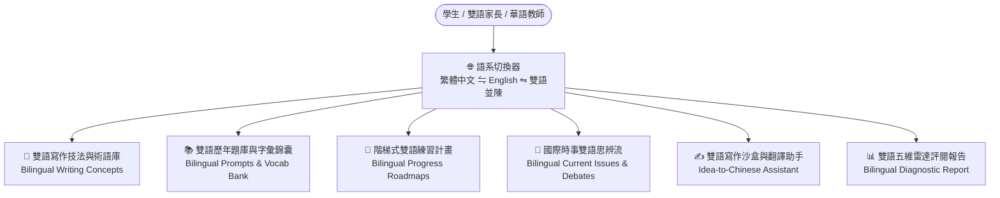
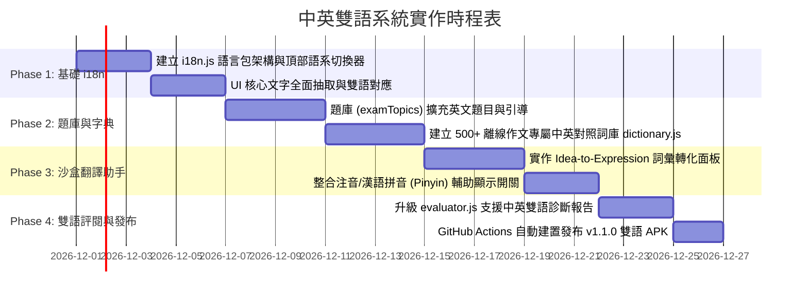

# 筆墨思潮 (WriteMaster) — 中英雙語教學與翻譯輔助系統規劃設計書 (Bilingual Scaffolding & Translation Plan)

> **專案擴充定位**：針對**母語為英語（English-Native / Bilingual Learners）**之學子，打造「**從英語思維到中文寫作表達**」的階梯式雙語鷹架教學平台。  
> 涵蓋：全系統中英雙語切換 (i18n)、寫作術語雙語對照、大考題庫與時事英文詮釋、即時英翻中寫作詞彙助手、拼音輔助與雙語診斷報告。

---

## 1. 學生痛點剖析與雙語教學目標



### 1.1 英語母語學生的核心挑戰
1. **思考與表達脫節**：學生在腦中能用英文組織出複雜深刻的論點，但中文詞彙量不足以精確轉化，容易退化成「小學流水帳」。
2. **文化與修辭隔閡**：對成語（Idioms）、譬喻（Metaphor）、四素記敘、起承轉合缺乏直覺感受。
3. **題意解讀困難**：面對台灣會考歷年題目的抽象寓意（如《未完成的夢》、《捨不得》），難以快速抓住題目的弦外之音。
4. **畏懼繁體字與生字**：閱讀中文審題指引時常因少數生字而產生挫折感。

### 1.2 核心教學目標
- **Low Friction（低阻力開端）**：全介面支援 English / 繁體中文雙語無縫切換，讓學生用熟悉的語言理解審題與架構。
- **Scaffolding（寫作鷹架）**：提供「英文概念 ➔ 中文成語/金句」的啟發式翻譯助手，而非死板的機器直譯。
- **Dual-language Feedback（雙語健檢回饋）**：五維雷達圖與改寫建議中英對照，明確知道優點與改進方向。

---

## 2. 系統架構與六大雙語模組 (Bilingual Modules)



---

## 3. 功能模組詳細規格設計

### 模組 1：UI/UX 國際化與語系切換 (i18n Engine)
- **頂部一鍵語系切換**：`繁體中文 (Traditional Chinese)` / `English` / `雙語對照 (Bilingual)`。
- **介面全面本地化**：
  - 導覽列：指引 Guide、題庫 Prompts、計畫 Plans、時事 News、沙盒 Studio。
  - 身分選單：
    - `Grade 1-2 (Elementary Low)` (國小低年級)
    - `Grade 3-4 (Elementary Mid)` (國小中年級)
    - `Grade 5-6 (Elementary High)` (國小高年級)
    - `Grade 7 (Junior High 1st Year)` (國中七年級)
    - `Grade 8 (Junior High 2nd Year)` (國中八年級)
    - `Grade 9 (CAP Exam Prep)` (國中九年級/會考衝刺)

### 模組 2：寫作術語與文法修辭對照庫 (Glossary)
| 中文寫作術語 | 英文對應標準術語 | 核心定義與學生引導 (English Guidance) |
| :--- | :--- | :--- |
| **起承轉合** | **Qi-Cheng-Zhuan-He**<br/>(Intro, Elaboration, Transition, Resolution) | Classical 4-part Chinese structure: Introduction ➔ Elaboration ➔ Conflict/Turn ➔ Philosophical Synthesis. |
| **審題與題眼** | **Prompt Deconstruction & Key Focus** | Analyzing prompt keywords, boundary limits, and implicit themes. |
| **立意取材** | **Theme Formulation & Material Selection** | Establishing a profound life message and selecting authentic personal anecdotes. |
| **五感摹寫** | **5 Sensory Imagery Writing** | Vivid sensory descriptions (Visual, Auditory, Olfactory, Gustatory, Tactile). |
| **譬喻修辭** | **Simile / Metaphor** | Connecting abstract emotions to vivid natural objects (`像...`, `好比...`). |
| **擬人修辭** | **Personification** | Giving human emotions, gestures, or words to non-human objects. |
| **排比修辭** | **Parallelism** | Three or more consecutive clauses with rhythmic, balanced grammatical structures. |
| **映襯對比** | **Contrast / Juxtaposition** | Placing opposing situations side by side to highlight tension and deeper truth. |

---

### 模組 3：雙語歷年題庫與詞彙包 (Bilingual Prompt Bank & Vocabulary Kits)
每一道題目皆配備專屬英文背景說明與「寫作必備詞彙庫 (Pinyin + English)」，例如：

#### 範例：會考真題《面對青少年的不滿》
* **English Title**: *Facing Adolescent Frustrations: Navigating Expectations and Growth*
* **Context in English**: "Examines the struggle between external expectations and inner adolescent emotions. Students reflect on misunderstandings and transform grievances into mature self-awareness."
* **Bilingual Structure Guide**:
  * 第一段【起】(Intro): Observe the labels placed on youth / 描繪青少年被誤解的現象。
  * 第二段【承】(Elaboration): A specific incident of frustration / 記敘一次感到不滿的具體事件。
  * 第三段【轉】(Turn): Empathy & perspective shift / 換位思考父母與師長的苦心。
  * 第四段【合】(Resolution): Inner resilience and growth / 昇華為破繭成蝶的自我對話。
* **Recommended Vocabulary Kit**:
  * 破繭而出 (`pò jiǎn ér chū`): Break through the cocoon / Emerge transformed
  * 苦口婆心 (`kǔ kǒu pó xīn`): Urge with earnest, caring words
  * 悵然若失 (`chàng rán ruò shī`): Feeling a sense of loss and melancholy
  * 逆境生花 (`nì jìng shēng huā`): Blossoming amidst adversity

---

### 模組 4：互動寫作沙盒中的「中英翻譯與表達助手」 (Idea-to-Chinese Assistant)
在寫作沙盒（Studio）輸入框旁，配置專屬行動端小工具：

1. **Idea-to-Expression 詞彙轉化器**：
   - 學生在輸入框輸入英文詞彙（如 `loneliness`, `never give up`, `sunset light`, `regret`）。
   - 系統即時提示 3 個不同語感層次的中文地道詞彙、成語及範例句，例如：
     - 輸入 `never give up` ➔ 提示：**堅持不懈**、**百折不撓**、**永不言棄**。
     - 點擊「一鍵插入」，直接將中文詞彙插入游標寫作處！
2. **段落中英雙語提示切換**：
   - 每個段落（起、承、轉、合）均有 English Prompt Tips 可展開。
3. **注音 / 拼音輔助開關 (Pinyin Toggle)**：
   - 針對國小低中年級學生，可切換開啟題目與範本的注音/漢語拼音顯示。

---

### 模組 5：雙語智能診斷評估報告 (Bilingual Evaluator)
評估完成後，報告面板提供雙語視圖：

| 評量維度 (Dimension) | 英文說明 (English Metric) | 診斷回饋範例 (Bilingual Feedback) |
| :--- | :--- | :--- |
| **篇幅完整度** | Content Length & Volume | ✅ Target met: 720 characters (目標達成：720 字，落於 650-1000 建議區間) |
| **結構組織力** | Structural Balance | ✅ Well-balanced 4 paragraphs (四段架構均衡，起承轉合明確) |
| **文采與修辭** | Rhetoric & Language Art | 🌟 Metaphors & Parallelism detected (成功識別譬喻與排比修辭) |
| **標點與規範** | Mechanics & Punctuation | ⚠️ English half-width commas detected (偵測到半形逗號，請換成全形 `，`) |
| **立意與情感** | Depth & Theme Resonance | 💎 Deep reflective synthesis (具備深層自我反省與哲思) |
| **預測級分** | Predicted Score Level | **Level 5 ~ 6 (Excellent / 結構完整且立意深遠)** |

---

## 4. 技術架構選型與實作方案

```
writing_app/
│
├── www/
│   ├── js/
│   │   ├── i18n.js                   # 🌐 國際化語言包 (英繁雙語切換字典)
│   │   ├── data.js                   # 📚 擴充雙語題庫、字彙錦囊、技法英譯
│   │   ├── dictionary.js             # 📖 離線中英作文核心成語與詞彙語義對照表 (500+條)
│   │   ├── translator.js             # 💡 英翻中寫作助手邏輯 (Idea-to-Expression Engine)
│   │   ├── evaluator.js              # 📊 雙語評估診斷引擎
│   │   └── app.js                    # 📱 UI 互動邏輯 (整合語系開關、拼音與翻譯彈窗)
│   ├── css/style.css                 # 雙語排版、拼音樣式與翻譯助手懸浮面板
│   └── index.html                    # 支援 i18n data-i18n 標籤之 HTML
│
└── BILINGUAL_PLAN.md                 # 本雙語規劃技術文檔
```

### 技術實作關鍵要點：
1. **100% 離線可用性 (Offline-First)**：
   - 內建 `dictionary.js`（預載 500+ 常見作文寫作詞彙、感官詞、情感詞、成語之英中映射）。
   - 手機無網路時依然能使用「詞彙助手」與「雙語題庫」！
2. **輕量級客戶端 i18n**：
   - 透過 `document.querySelectorAll('[data-i18n]')` 進行零相依性（Zero-dependency）的高速 DOM 本地化切換，不增加 APK 體積（維持 < 5MB）。
3. **在線翻譯擴展插槽 (Optional Online Fallback)**：
   - 若學生輸入自訂整段英文長句，可平滑呼叫瀏覽器內建翻譯 API，或外接免費開放翻譯接口。

---

## 5. 四階段實作里程碑 (Roadmap)



---

## 6. 結論與預期效益

透過本雙語規劃，**筆墨思潮 (WriteMaster)** 將突破單一華語母語市場：
1. **全面覆蓋國際學校、雙語學童與海外華裔家庭**。
2. 讓母語是英文的學生克服對繁體中文寫作的恐懼，建立「用英文深度思考，用優美中文精準表達」的高階素養。
3. 為家長與國際學校華語教師提供清晰客觀的中英雙語教學工具與評量依據。
