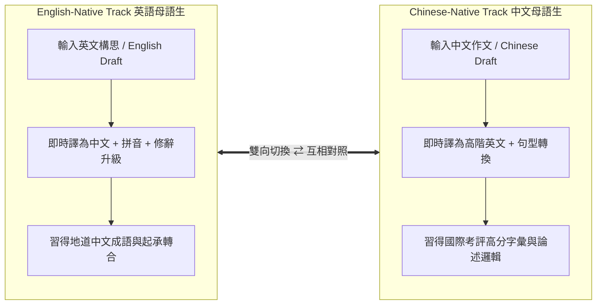
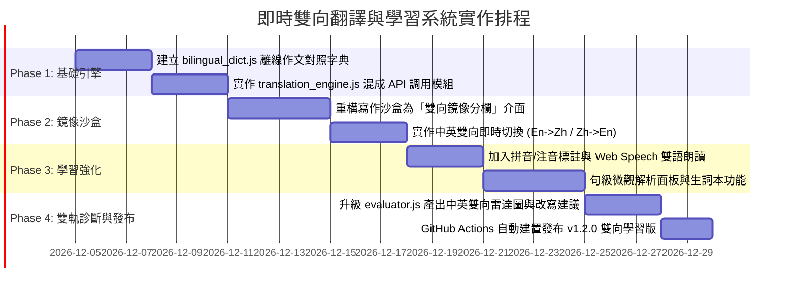

# 筆墨思潮 (WriteMaster) — 即時雙向翻譯與雙向寫作學習系統規劃架構書 (Bidirectional Real-Time Translation & Learning Plan)

> **核心願景**：打破單向「機器翻譯」的刻板模式，打造專為中小學生設計的**「雙向鏡像寫作學習系統 (Mirror Writing Studio)」**。  
> 既能讓**英文母語學生**「寫英文 ➔ 即時轉化為生動優美中文作文」，又能讓**中文母語學生**「寫中文 ➔ 同步學習高階道地英文寫作表達」，實現真正的雙向語言賦能與文化思維互通。

---

## 1. 雙向學習 (Bidirectional Learning) 核心理念



### 1.1 傳統翻譯工具 vs. 雙向寫作學習系統
| 比較維度 | 一般翻譯軟體 (Google/DeepL) | WriteMaster 雙向寫作學習系統 |
| :--- | :--- | :--- |
| **翻譯目標** | 僅求字面語意傳達，易流於死板或生硬直譯 | **針對作文考評優化**：自動推薦適合學齡的修辭、成語與五感描寫 |
| **學習反饋** | 只有單一結果，無教學解釋 | **句級分解教學**：標註生詞、拼音、詞性、文法轉換邏輯與替換金句 |
| **結構對齊** | 整篇混在一起，段落關係模糊 | **起承轉合四段鏡像對齊**：逐段即時同步翻譯，清晰掌握結構對照 |
| **修辭升級** | 不會主動優化平淡句式 | **一鍵「修辭潤色 (Polish)」**：可將平淡句升級為「比喻句」、「排比句」 |

---

## 2. 雙向鏡像寫作沙盒 (Mirror Writing Studio) 介面規劃

```
+-------------------------------------------------------------------------+
|  ✍️ 筆墨思潮 - 雙向寫作學習室 (Mirror Writing Studio)                    |
|  [ 模式切換: 🇺🇸 寫英翻中 (En->Zh)  ⇄  🇹🇼 寫中翻英 (Zh->En) ] [🌐 語音朗讀] |
+-------------------------------------------------------------------------+
|  【左側：創作輸入區 (Source Editor)】     | 【右側：即時鏡像學習區 (Target Mirror)】   |
|                                         |                                         |
|  ▼ 第一段【起】(Intro)                   | ▼ 第一段【起】(Intro Mirror)             |
|  Life is like a box of chocolates;      | 生活宛如一盒未拆封的巧克力； (譬喻法)    |
|  you never know what flavor you'll get. | 在品嚐之前，你永遠不知下一個滋味是什麼。   |
|                                         | [拼音: Shēnghuó wǎnrú...] [🔊 朗讀]      |
|                                         | [💡 詞彙拆解: 宛如=just like; 滋味=flavor] |
|                                         |                                         |
|  ▼ 第二段【承】(Elaboration)             | ▼ 第二段【承】(Elaboration Mirror)        |
|  When I failed the piano exam...        | 當我鋼琴檢定失利的那天，窗外雷雨大作...  |
|  [輸入中... 即時動態反饋]                | [💡 高級成語建議: 悵然若失、灰心喪志]     |
|                                         |                                         |
|  ▼ 第三段【轉】(Conflict / Turn)         | ▼ 第三段【轉】(Turn Mirror)              |
|  ...                                    | ...                                     |
|                                         |                                         |
|  ▼ 第四段【合】(Resolution / Synthesis) | ▼ 第四段【合】(Resolution Mirror)       |
|  ...                                    | ...                                     |
+-------------------------------------------------------------------------+
|  [ ⚡ 一鍵雙語五維雷達診斷 ]  [ 📋 匯出雙語對照文稿 ]  [ 💾 存入生詞本 ]       |
+-------------------------------------------------------------------------+
```

---

## 3. 五大核心功能與學習機制

### 3.1 寫英文翻中文 (En ➔ Zh Mode)：英文思維 ➔ 地道中文作文
* **專為國際學生/英語母語生設計**：
  1. 學生在輸入框以英文自由書寫內心想法，消除對中文生字的恐懼。
  2. 系統**段落同步翻譯**為符合台灣國語文與大考評分標準的地道中文。
  3. **自動修辭升級 (Rhetoric Enhancement)**：
     - 若學生輸入：*“I was very sad because I lost.”*
     - 系統轉化推薦：*「落選的那一刻，我的心情如同跌入冰冷的深淵，悵然若失。」*（融入五感與成語）。
  4. **注音 / 拼音與語音朗讀 (TTS)**：
     - 中文翻譯結果上方可隨時開啟注音/拼音標註，點擊喇叭圖示即時真人發音朗讀，強化聽讀整合。

### 3.2 寫中文翻英文 (Zh ➔ En Mode)：中文作文 ➔ 國際頂尖英文寫作
* **專為台灣/華語學生英文寫作賦能**：
  1. 學生輸入中文作文草稿（如學校會考作文、日記、讀書心得）。
  2. 系統同步產出具備**托福/雅思/SAT 寫作水準**的地道英文（Academic & Narrative English）。
  3. **消滅中式英文 (Chinglish Detector)**：
     - 將直譯結構（如 *“people mountain people sea”* 或 *“my heart very painful”*）自動校正為生動表達（*“a bustling sea of faces”*、*“a wave of sharp sorrow washed over me”*）。
  4. **高級轉折詞提示庫**：
     - 提示 *Conversely, In hindsight, Epitomizing, A profound testament to...* 等英美名校寫作轉折語。

### 3.3 句級微觀學習對照器 (Sentence-by-Sentence Breakdown)
點擊文章中的任一句話，立即彈出學習面板：
- **詞性與結構拆解**：主詞、動詞、修飾語在中英文中的順序顛倒與文化差異。
- **近義詞階梯 (Synonym Ladder)**：
  - 基礎詞：`Happy` ➔ 進階詞：`Joyful` ➔ 頂級書面詞：`Euphoric / 欣喜若狂、雀躍不已`。
- **一鍵替換**：學生可在 3 種不同文采風格（樸實敘事、深層抒情、哲理思辨）中自由切換目標句。

### 3.4 雙語生詞與佳句筆記本 (Bilingual Word & Sentence Bank)
- 寫作過程中遇到的優美成語或高級英文單字，點擊「⭐ 收藏」即可存入學生的個人雲端筆記本。
- 支援「閃卡模式 (Flashcards)」每日複習打卡。

### 3.5 雙語五維雷達評審報告 (Bilingual Evaluation Matrix)
- 點擊「開始智能診斷」後，系統同時對中文稿與英文稿進行**雙軌評分**：
  1. **中文維度**：篇幅字數、起承轉合完整度、成語修辭密度、全形標點規範。
  2. **英文維度**：Word Count, Paragraph Cohesion, Lexical Variety, Grammar & Syntax.
  3. 產出雙語對照雷達分析圖與中英雙語教師評語。

---

## 4. 系統技術架構與混成翻譯引擎 (Hybrid Translation Engine)

為兼顧**手機離線可用性 (Offline-First)** 與**在線高品質翻譯 (High Quality)**，系統設計三層混成翻譯架構：

```mermaid
flowchart TD
    UserInput[學生輸入文本 (中文或英文)] --> ModeCheck{連網狀態與使用者設定}
    
    ModeCheck -->|斷網/飛航模式| L1[Level 1: 離線寫作詞典與模板引擎<br/>500+成語/常用句式/起承轉合骨架]
    ModeCheck -->|一般網路連線| L2[Level 2: 免費開源即時翻譯 API<br/>MyMemory / LibreTranslate / 瀏覽器內建翻譯]
    ModeCheck -->|進階教育模式<br/>(可選配置 API Key)| L3[Level 3: AI 作文導師引擎<br/>Gemini 1.5/3.5 / OpenAI GPT<br/>具備修辭升級與教學註解]
    
    L1 --> OutputView[雙語鏡像沙盒展示]
    L2 --> OutputView
    L3 --> OutputView
```

### 4.1 三層引擎職責分配：
1. **Level 1 (離線基礎層)**：
   - 內建於 APK / PWA 資產庫中（`bilingual_dict.js`）。
   - 提供 1,000+ 核心寫作成語、五感詞、標題、過渡句與常用結構的極速中英互譯，**無網路 100% 正常運作**。
2. **Level 2 (在線免費層)**：
   - 整合免費即時翻譯 API（具備自動降級容錯重試機制），無須學生填寫任何 API 金鑰即可直接整句翻譯。
3. **Level 3 (AI 智慧導師層 - 可選)**：
   - 開放學生或學校老師填入自訂 API Key（如 Google Gemini 或 OpenAI）。
   - 啟用後可享有一流的「作文修辭升級」、「逐句文采潤色」與「深度教學解析」。

---

## 5. 檔案模組規劃與工程目錄

```
d:\ams14\writing_app/
│
├── www/
│   ├── js/
│   │   ├── translation_engine.js      # ⚡ 混成翻譯核心 (離線字典 + 在線 API + 容錯降級)
│   │   ├── bilingual_dict.js          # 📖 離線高階作文成語與金句對照庫 (1,000+條)
│   │   ├── mirror_studio.js           # 🪞 雙向鏡像寫作沙盒 UI 與段落同步滾動
│   │   ├── speech_synthesizer.js      # 🔊 中英雙語即時語音朗讀模組 (Web Speech API)
│   │   ├── evaluator.js               # 📊 雙語五維雷達圖評閱引擎
│   │   └── app.js                     # 📱 主程式整合與語系切換
│   ├── css/
│   │   └── style.css                  # 鏡像分欄、雙語卡片、拼音標註與生詞面板樣式
│   └── index.html                     # 雙向寫作沙盒介面結構
│
└── REALTIME_TRANSLATION_PLAN.md       # 本專案完整規格設計文件
```

---

## 6. 四階段排程與實作里程碑 (Roadmap)



---

## 7. 預期效益與教育價值

1. **破除雙向語言壁壘**：
   - 英文母語孩子不再因為中文生字而放棄表達豐富思想。
   - 華語孩子不再害怕寫英文作文，能藉由中文長處帶動英文寫作深度。
2. **真正的雙向賦能 (Dual Empowerment)**：
   - 將「單純的批改軟體」升級為「全天候 1 對 1 雙語寫作陪練導師」。
3. **無痛適應國際大考與會考**：
   - 同步接軌台灣國中教育會考六級分標準與國際 IB / AP / 托福英文寫作思維。
