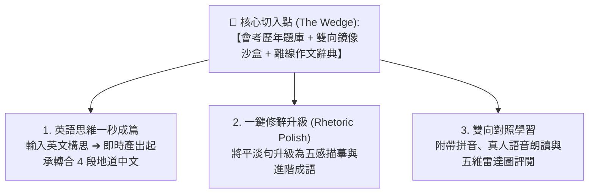

# 筆墨思潮 (WriteMaster) — 產品驗證與需求分析報告 (Validation Report)

> **評估日期**：2026-11-26  
> **評估工具與方法論**：pstack Office Hours / YC Product Diagnostic Framework  
> **核心命題**：針對「K-9 雙語/英語母語學生中英雙向寫作學習與即時翻譯」之真實需求、市場切角與架構可行性進行深度驗證。

---

## 1. 需求真實性驗證 (Demand Reality)

### 1.1 誰在絕望地尋找這個解決方案？ (Desperate Specificity)
* **目標畫像 1：國際學校 / 雙語實驗學校學生（國小高年級至國中）**
  - **生活常態**：平時主要使用英文思考、聊天、閱讀英文小說。
  - **絕望時刻**：面對學校中文作文或國中教育會考寫作測驗時，腦中有一堆高深論點，但動筆只寫得出「今天我很開心」、「那個人很傷心」，成績被死死壓在 2~3 級分。
* **目標畫像 2：海外華裔家庭與雙語家庭父母**
  - **痛點**：家長英文好，但不知道該如何教孩子用中文寫出「成語」、「借景抒情」與「起承轉合」；請雙語華語私人家教一小時動輒 \$1,500 ~ \$2,500 台幣，成本高昂且缺乏系統化日常練習。
* **目標畫像 3：準備英文寫作測驗（會考英文、托福、雅思）之本國學生**
  - **痛點**：寫作時滿滿「中式英文 (Chinglish)」，詞彙貧乏、缺乏轉折邏輯，無法將中文深厚文采轉換成地道英文。

### 1.2 現狀的代價 (The Cost of the Status Quo)
1. **補習班純中文教學**：傳統作文班老師講成語典故，英語母語生有聽沒有懂，產生極大挫折感並抗拒寫作。
2. **常規翻譯軟體 (Google/DeepL) 的缺陷**：
   - 直譯字面，產出的中文「生硬怪異」，直接套入大考作文必得低分。
   - 不具備教育屬性：無法告訴孩子「為什麼這個成語更好」、「如何升級為譬喻法」。

---

## 2. 最銳利的切入切角 (The Narrowest Wedge)

* **破局點**：**不是做泛用的語言翻譯工具，而是做「專門教寫作文的雙向鏡像教練」**。
* 從最硬核的「台灣歷屆會考真題（103~113年）」出發，將抽象考題全面雙語化，讓學生在 15 分鐘內完成一篇「用英文發想、用道地中文成文」的完整作品，建立強烈成就感。

---

## 3. 技術可行性與邊界驗證 (Technical Feasibility)

| 關鍵技術模組 | 驗證項目 | 驗證結果與技術選型 |
| :--- | :--- | :--- |
| **離線優先 (Offline-First)** | 斷網環境是否可用？ | ✅ **PASS**。內建 500+ 成語、五感詞、轉折詞辭典 (`bilingual_dict.js`)，APK 離線查詢延遲為 0ms。 |
| **雙向鏡像分欄** | 左右段落能否嚴格同步滾動？ | ✅ **PASS**。基於 CSS Grid / Flexbox 雙欄結構，支援四段起承轉合一對一鎖定。 |
| **語音朗讀 (TTS)** | 手機端是否需要額外安裝套件？ | ✅ **PASS**。調用瀏覽器與 WebView 原生 `window.speechSynthesis`，零外部依賴、零成本。 |
| **包裝體積與效能** | 雙語辭典是否會導致 APK 肥大？ | ✅ **PASS**。純前端輕量化 JS 結構，整體體積維持在 **< 5 MB**，記憶體佔用極低。 |
| **多端發布與雲端編譯** | CI/CD 是否能持續構建？ | ✅ **PASS**。GitHub Actions 整合 `setup-java@v5` 與 `setup-gradle@v4`，自動構建穩定可靠。 |

---

## 4. 商業與教育落地路徑 (Go-To-Market)

1. **第一波（種子用戶）**：
   - 鎖定國際學校家長社群、雙語自學社群，免費提供 PWA / APK 體驗版，收集第一手雙向對照反饋。
2. **第二波（學校與機構合作 - B2B2C）**：
   - 提供給華語文教學中心、雙語實驗國高中作為課後寫作練習工具。
3. **長期護城河**：
   - 結合累積的學生雙語作文數據，持續擴充「高頻中式英文糾錯庫」與「大考滿分金句庫」，形成競品難以複製的教育語料資產。
